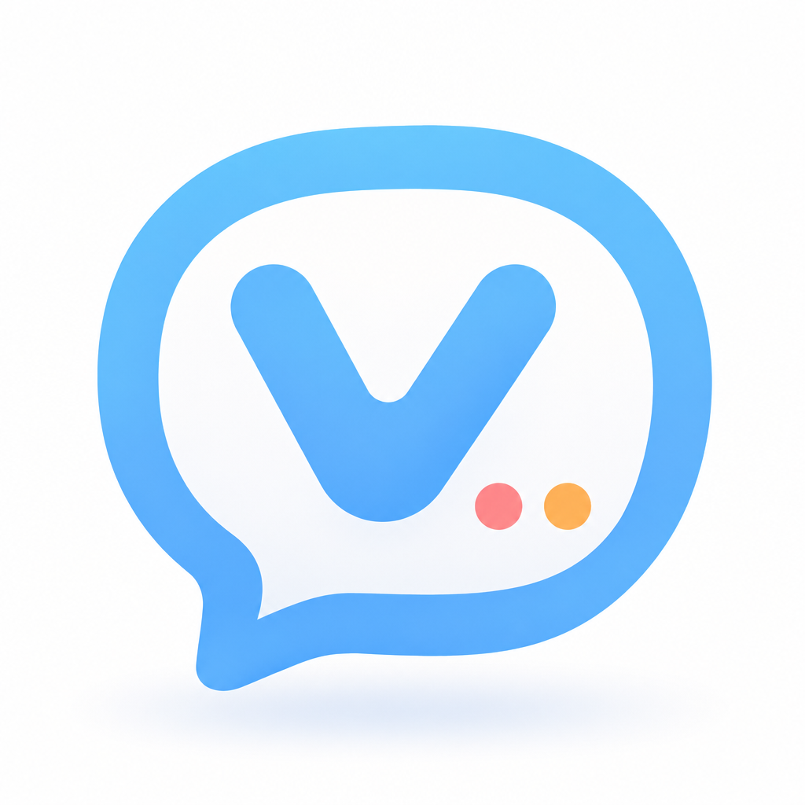
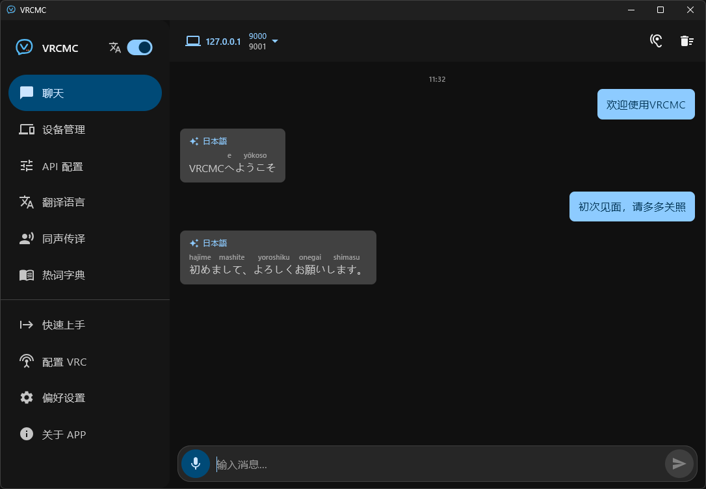

<div align="center">
  
  <h1>VRCMC</h1>
  <p><strong>把翻译后的消息，轻松送进 VRChat。</strong></p>
  <p>
    
    
    
    <a href="LICENSE"></a>
  </p>
</div>

<div align="center">
  <strong>简体中文</strong> ·
  <a href="README.zh-TW.md">繁體中文</a> ·
  <a href="README.en.md">English</a> ·
  <a href="README.ja.md">日本語</a>
</div>

VRCMC 是一款基于 Kotlin Multiplatform 与 Compose Multiplatform 开发的 VRChat Chatbox 助手。它通过 OSC 在局域网内连接 VRChat，并可在发送消息前调用翻译服务，适合跨语言聊天、语音输入与实时交流。

<p align="center">
  
</p>

> [!NOTE]
> VRCMC 是独立的开源项目，与 VRChat Inc. 没有关联。VRChat 是其各自所有者的商标。

## 功能亮点

- **VRChat Chatbox**：通过 OSC 向同一台电脑或局域网中的 VRChat 发送消息。可保存多个设备并切换，桌面版和 Android 还可扫描局域网设备；只填 IP 时使用 `9000:IP:9001`，也可指定收发端口。输入框会根据 Chatbox 的 144 字符、9 行限制和输出语言数量计算字符上限，可在偏好设置中关闭动态字符限制。
- **翻译服务**：API 页面可选择 Qwen、Microsoft Edge Web（Bing）、DeepSeek、OpenAI/GPT 或自定义兼容端点。可按服务支持情况设置 API Key、Base URL、模型、超时、重试、备用模型、自定义请求头和流式响应。
- **翻译输出**：最多选择两种目标语言，设置是否显示原文、换行方式和原文/译文顺序，也可以先发送原文再发送译文。
- **语音输入**：可使用 Qwen Fun-ASR 云端识别。Windows x64 支持 SenseVoice Small INT8、Fun-ASR-Nano INT8 和 Qwen3-ASR 0.6B INT8 本地识别；Android ARM64 支持 Qwen3-ASR 0.6B INT8 本地识别。已下载模型可删除，桌面版可选择麦克风，移动端需要麦克风权限。
- **同声传译**：可配合系统语音输入或应用内识别。开启后会根据 VRChat 麦克风状态采集语音，闭麦后翻译并发送；“始终传译”会在输入暂停后自动发送，并可合并快速连续消息。
- **听别人说话（Windows）**：点击聊天页右上角的耳朵按钮，监听 Windows 默认播放设备并在本地检测人声，在置顶字幕窗口中按句显示原文和一种译文。窗口可调整大小、最小化和不透明度，设置中可选择听的语言和目标语言。
- **SteamVR 叠加界面**：可在字幕设置中开启，位置支持左手、右手或屏幕中间；手部面板跟随控制器，屏幕中间面板跟随头显。大小可选 50%–200%，字幕字号可独立选择 75%–200%，与桌面字幕共用 30%–100% 的不透明度，需要 SteamVR 和已连接的头显。
- **消息朗读**：启用 Edge TTS 后，可选择朗读原文、译文或最终发送文本，支持音色试听；桌面版可选择播放设备。朗读文本会发送到微软进行语音合成。
- **热词字典**：在发送前替换关键词或屏蔽整句，支持 JSON 导入导出。
- **本地设置**：支持浅色、深色和跟随系统主题，界面提供简体中文、繁体中文、English 和日本語；可选显示日文罗马字，聊天记录和错误日志保存在本机。
- **应用内更新**：应用会检查 GitHub 最新版本，可在偏好设置中关闭检查。Android 和 Windows 可直接下载并启动安装包；iOS 会打开发布页。

## 快速开始

1. 打开“快速上手”，测试 Qwen API Key，或直接选择无需 API Key 的 Edge Web 翻译。
2. 打开“配置 VRC”，将生成的 `--osc=9000:<VRCMC 的局域网 IP>:9001` 填入 Steam 中 VRChat 的启动选项，然后重启 VRChat。同一台电脑运行两者时使用 `127.0.0.1`。
3. 打开“设备管理”，添加运行 VRChat 的电脑 IP；只填 IP 会使用默认端口 9000/9001。
4. 在 API、翻译语言、语音输入和偏好设置中按需开启功能。

## 翻译服务

服务选择器当前提供 Qwen、Microsoft Edge Web（Bing）、DeepSeek、OpenAI/GPT 和自定义兼容端点。自定义端点可选择 OpenAI-compatible 或 Anthropic-compatible 协议。

Edge Web 是无需 API Key 的公共网页接口，不是 Azure AI Translator API，可能受到限流、变更或停止服务。使用第三方服务时，待翻译文本会发送到所选服务，请自行查看其条款和隐私政策。

## 数据与安全

- 设备信息、聊天记录、应用设置、热词字典和错误日志默认保存在本机。
- API Key 和自定义鉴权请求头与普通设置分开保存；Android 使用 Android Keystore，Windows 使用 DPAPI，iOS 使用 Keychain。其他桌面系统不会持久化这些敏感配置。
- 云端语音识别会将录音发送到所选服务；本地识别模型在设备上处理音频，不会回退到云端。翻译文本会发送到配置的翻译服务，Edge TTS 会将朗读文本发送到微软。
- “听别人说话”只在字幕窗口显示识别结果，不写入聊天记录、不发送到 VRChat，也不触发朗读；它监听启动时的 Windows 默认播放设备，切换设备后需要重新开启。
- Android 已关闭应用数据备份。


## 项目结构

```text
VRCMC/
├── composeApp/
│   └── src/
│       ├── commonMain/   # 共享 UI、状态、翻译与 OSC 接口
│       ├── androidMain/  # Android 平台实现
│       ├── desktopMain/  # JVM 桌面平台实现
│       ├── iosMain/      # iOS 平台实现
│       └── commonTest/   # 共享逻辑测试
├── gradle/               # Gradle Wrapper 与版本目录
├── image/                # 项目图片资源
└── LICENSE
```

## 开发环境（mise）

项目根目录的 `mise.toml` 固定 Temurin JDK 21，Gradle 使用仓库自带的 Wrapper，无需另行安装 Kotlin 或 Gradle。安装 mise 后执行：

```powershell
mise trust
mise install
mise run doctor
mise run build
mise run test
mise run dev
```

`mise run` 自动使用项目 JDK，无需修改系统 `JAVA_HOME`。Android 开发还需 Android SDK（Platform 36），通过 `ANDROID_HOME` 或未纳入版本控制的 `local.properties` 中的 `sdk.dir` 指定路径，再运行 `mise run android`。iOS 开发需要 macOS 和 Xcode，无法在 Windows 上构建。

Windows 发布目录使用 `mise run package` 生成；安装包的额外要求和可选语音集成测试依赖见 [WINDOWS_EXE_PACKAGING.md](WINDOWS_EXE_PACKAGING.md)。

## 参与贡献

欢迎提交 Issue 与 Pull Request。提交改动前，请尽量保持平台实现的一致性，并运行与改动范围对应的测试。涉及 OSC、翻译请求或配置存储时，建议同时补充共享逻辑测试。

## 许可证

本项目基于 [MIT License](LICENSE) 开源。
